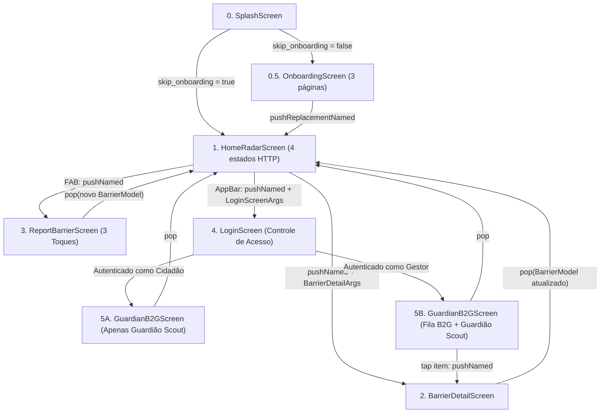

# Caminho Livre — Mobilidade Urbana Inclusiva & Zeladoria Preditiva (CitizenTech)

> **Global Solution 2026 — Desenvolvimento Cross-Platform (Flutter & Dart) — 3SI / FIAP**

---

## 1. Desenvolvedores (Identificação Obrigatória)

| Nome Completo (Sem Abreviações) | RM |
| :--- | :--- |
| Gabriel José Lima da Silva | RM 556695 |
| Lucas Vendramini Lubianco | RM 556161 |
| Gabriel Doná Braga Araujo | RM 558142 |

---

## 2. Descrição da Solução

Nas metrópoles brasileiras, milhões de cidadãos com restrições de mobilidade — incluindo **cadeirantes, pessoas com deficiência visual ou baixa visão, idosos e pais com carrinhos de bebê** — descobrem que uma calçada é fisicamente intransponível apenas quando já estão retidos no percurso. Ausência de rampas (rebaixamento de guia), calçadas esburacadas ou estreitas ($< 1,20\text{ m}$), falta de piso tátil e iluminação precária transformam deslocamentos básicos até Unidades Básicas de Saúde (UBSs), escolas e transporte público em jornadas de alto risco físico.

O **Caminho Livre** é uma plataforma **CitizenTech** que fecha o ciclo entre **mobilidade urbana inclusiva**, **engajamento comunitário gamificado** e **zeladoria pública preditiva (B2G)**:

1. **Roteamento e Radar Adaptativo por Perfil Biomecânico:** Avalia cada barreira urbana segundo os parâmetros físicos tolerados por 5 personas (*Cadeirante*, *Deficiência Visual*, *Idoso*, *Carrinho de Bebê* e *Guardião Scout*), sinalizando em tempo real onde há **Bloqueio Físico ($\text{Custo} = \infty$)** segundo a norma ABNT NBR 9050.
2. **Crowdsourcing Gamificado ("Guardiões da Calçada"):** Para superar a escassez inicial de dados geoespaciais (*cold start*), cidadãos atuam como auditores territoriais (*Scouts*), relatando obstáculos em **3 toques** (+50 XP) e validando barreiras existentes com o botão **"Ainda está lá?"** (+15 XP), subindo de nível e desbloqueando insígnias de impacto social.
3. **Painel do Gestor Público & Score B2G com Controle de Acesso:** Converte os relatos auditados em uma fila matemática de priorização de obras públicas para prefeituras e subprefeituras, aplicando multiplicadores espaciais para obstáculos situados no entorno de UBSs, hospitais e escolas. A visualização e gerenciamento da fila de obras é **estritamente restrita a funcionários públicos especializados credenciados**, garantindo governança pública e proteção de dados.

---

## 3. Perfis de Acesso e Credenciais de Teste (RBAC)

Para atender à regra de governança em que **usuários comuns não podem acessar a fila de obras da prefeitura**, foi implementada uma tela de autenticação e controle de acesso com validação de credenciais e persistência de sessão.

Abaixo estão os dois perfis oficiais cadastrados para teste e avaliação da banca examinadora:

| Perfil | Usuário / E-mail | Senha | Nome do Usuário | Escopo de Visão e Permissões |
| :--- | :--- | :--- | :--- | :--- |
| **1. Cidadão Comum (Scout da Calçada)** | `cidadao@caminholivre.com.br`<br>*(ou apenas `cidadao`)* | `123456` | Ana Cidadã (Scout da Calçada) | • **Acesso exclusivo à visão Guardião Scout** (XP acumulado, nível de Scout, barra de progresso, contador de empatia tangível e GridView de insígnias sociais).<br>• **A "Fila de Obras B2G" fica 100% oculta e inacessível** (sem abas). |
| **2. Gestor Público Especializado (B2G)** | `gestor@sp.gov.br`<br>*(ou apenas `gestor`)* | `gestor123`<br>*(ou `admin123`)* | Dr. Carlos Mendes (Engenheiro B2G) | • **Acesso irrestrito a ambas as visões**:<br>1. **Guardião Scout (XP)**;<br>2. **Fila de Obras B2G** (ordenada decrescentemente pelo Score B2G matemático, filtros por status *Aberto* / *Em Análise* / *Resolvido* e botão para avançar o ciclo de vida da obra municipal). |

> **Dica para Testes Rápidos:** Na própria tela de Login há botões de 1 clique (*"Preencher Cidadão Comum"* e *"Preencher Gestor Público B2G"*), permitindo testar ambas as experiências em segundos no emulador ou dispositivo móvel sem necessidade de digitação manual.

---

## 4. Tema da Global Solution (CitizenTech) e Alinhamento com os ODS da ONU

A solução materializa o propósito **CitizenTech** — tecnologia centrada no cidadão para resolver problemas reais do território urbano e orientar políticas públicas baseadas em evidências — contribuindo diretamente para quatro **Objetivos de Desenvolvimento Sustentável (ODS)** da Agenda 2030 da ONU:

| ODS da ONU | Metas Endereçadas | Materialização Técnica no Caminho Livre |
| :--- | :--- | :--- |
| **ODS 11 — Cidades e Comunidades Sustentáveis** | Metas 11.2 e 11.7 | Mapeamento de microacessibilidade em calçadas e travessias parametrizado por perfil biomecânico. |
| **ODS 10 — Redução das Desigualdades** | Meta 10.2 | Eliminação da assimetria informacional no deslocamento de pessoas com deficiência e mobilidade reduzida. |
| **ODS 9 — Indústria, Inovação e Infraestrutura** | Meta 9.1 | Algoritmo matemático de **Score B2G** que direciona investimentos de engenharia municipal para gargalos críticos. |
| **ODS 3 — Saúde e Bem-Estar** | Meta 3.6 | Prevenção direta de quedas severas em idosos e acidentes no passeio público. |

### Modelagem Matemática Implementada

- **Equação de Custo Dinâmico de Trecho por Perfil:**
  $$\text{Custo}(e, P) = L_e \cdot \left(W_{\text{base}} + \sum P_{\text{barreira}}(P)\right)$$
  Para um cadeirante diante de uma escadaria ou travessia sem rampa, $P_{\text{barreira}} = \infty$, sinalizando bloqueio físico imediato.
- **Equação Oficial de Score de Priorização B2G:**
  $$\text{Score}_{\text{B2G}} = \text{Gravidade} \times (1 + \text{Confirmações}) \times F_{\text{proximidade}} \times \text{Decaimento}_{\text{idade}}$$

---

## 5. Fluxo de Telas e Navegação (`Navigator`)

O aplicativo possui **7 telas** implementadas com `StatefulWidget`, gerenciamento de estado via `setState` e navegação com `Navigator` por rotas nomeadas e passagem tipada de argumentos:



| Tela | Arquivo | Papel Funcional |
| :--- | :--- | :--- |
| **0. Splash** | `lib/screens/splash_screen.dart` | Exibe o logo com `Image.asset`, aguarda 2 segundos e consulta `skip_onboarding` no `SharedPreferences` para redirecionar automaticamente. |
| **0.5. Onboarding** | `lib/screens/onboarding_screen.dart` | `PageView` com 3 páginas (Imagem/Ícone, Título, Descrição e ODS), botões *Voltar* e *Avançar/Concluir* e opção **"Não mostrar novamente"** persistida no `SharedPreferences`. |
| **1. Radar de Barreiras** | `lib/screens/home_radar_screen.dart` | Seleciona o Perfil Biomecânico em tempo real, busca por rua/bairro, filtra bloqueios/monitoradas e gerencia os **4 estados** da requisição HTTP (*Inicial*, *Carregamento*, *Sucesso* e *Erro* com botão "Tentar Novamente"). |
| **2. Detalhes & Auditoria** | `lib/screens/barrier_detail_screen.dart` | Recebe o `BarrierModel`, exibe foto anonimizada (`Image.network` + Blur LGPD), detalha o `Custo_Trecho` e valida **"Ainda está lá?"** (+15 XP e recálculo instantâneo do Score B2G). |
| **3. Relato em 3 Toques** | `lib/screens/report_barrier_screen.dart` | Permite cadastrar um novo obstáculo em 3 interações (Categoria, Gravidade 1–5 e Proximidade de UBS/Escola), concedendo **+50 XP** e inserindo a barreira no Radar. |
| **4. Login / Controle de Acesso** | `lib/screens/login_screen.dart` | Formulário de autenticação que valida se o usuário é Cidadão Comum ou Gestor Público B2G, com atalhos de preenchimento rápido para testes. |
| **5. Guardião & B2G** | `lib/screens/guardian_b2g_screen.dart` | • **Visão Cidadão:** Acesso exclusivo ao Guardião Scout (nível, XP, empatia e GridView de insígnias).<br>• **Visão Gestor:** Acesso completo com TabBar alternando entre Guardião Scout e a Fila de Obras da Prefeitura por Score B2G. |

---

## 6. Prints das Telas em Funcionamento

| Tela / Estado | Captura de Tela |
| :--- | :--- |
| **1. Tela de Splash (`SplashScreen`)** |  |
| **2. Onboarding — Páginas 1, 2 e 3 + "Não mostrar novamente"** |  |
| **3. Radar — Estado Inicial (`RequestState.initial`)** |  |
| **4. Radar — Estado de Sucesso (`RequestState.success`)** |  |
| **5. Detalhes da Barreira & Validação "Ainda está lá?"** |  |
| **6. Relato Rápido em 3 Toques (+50 XP)** |  |
| **7. Tela de Login e Controle de Perfil (`LoginScreen`)** |  |
| **8. Visão Cidadão: Apenas Guardião Scout (`GuardianB2GScreen`)** |  |
| **9. Visão Gestor: Fila de Obras B2G da Prefeitura (`GuardianB2GScreen`)** |  |

---

## 7. API Utilizada (API REST Caminho Livre — São Paulo/SP)

O aplicativo consome o WebService REST JSON desenvolvido para o projeto (`barriers_sp.json`) utilizando o pacote `http` (`http.get`). O endpoint retorna as barreiras urbanas georreferenciadas do **Município de São Paulo** com dados estruturados para avaliação biomecânica e priorização pública B2G:

- **Endpoint Oficial (GET):**
  `https://gist.githubusercontent.com/GabrielJS2005/1299682cf15857deae0ebcb58494988f/raw/barriers_sp.json`
- **Exemplo de Payload JSON Retornado:**
  ```json
  [
    {
      "id": "SP-1001",
      "title": "Meio-fio Elevado sem Rebaixamento (kerb=raised)",
      "category": "Ausência de Rampa",
      "address": "Av. Paulista, 1106 - Bela Vista (Próx. Metrô Trianon-Masp)",
      "severity": 5,
      "confirmations": 12,
      "proximityFactor": 2.0,
      "ageDecay": 1.0,
      "status": "Aberto",
      "imageUrl": "https://picsum.photos/seed/sp1001/600/400"
    }
  ]
  ```
- **Tratamento dos 4 Estados Obrigatórios (Requisito 4):**
  1. *Inicial:* Card de boas-vindas e botão **"Escanear Malha Urbana (São Paulo - SP)"** para disparar a consulta.
  2. *Carregamento:* `CircularProgressIndicator` centralizado.
  3. *Sucesso:* `ListView.builder` de cards interativos com destaque para Bloqueio Físico ($\text{Custo} = \infty$).
  4. *Erro:* Mensagem amigável com ícone de alerta e botão **"Tentar Novamente"**.

---

## 8. Explicação da Arquitetura e Boas Práticas

O código-fonte em `lib/` segue separação estrita de responsabilidades para manter todas as regras de negócio desacopladas dos widgets de interface:

```text
lib/
├── main.dart                        # MaterialApp, tema Alto Contraste WCAG e onGenerateRoute
├── app/
│   ├── app_routes.dart              # Constantes das 7 rotas nomeadas
│   └── app_theme.dart               # Tema Material 3 de alto contraste e alvos >= 48x48dp
├── models/
│   ├── barrier_category.dart        # Enum das 7 categorias de barreira (rótulo, ícone, cor)
│   ├── barrier_model.dart           # Entidade, Score B2G e factory BarrierModel.fromJson
│   ├── barrier_status.dart          # Enum dos estágios B2G (Aberto, Em Análise, Resolvido)
│   ├── guardian_progress.dart       # Modelo de progresso de XP, nível e insígnias
│   ├── mobility_profile.dart        # Enum dos 5 perfis biomecânicos e limites NBR 9050
│   ├── onboarding_page_data.dart    # Modelo das páginas do Onboarding
│   └── user_role.dart               # Enums e modelo de perfil de usuário (Cidadão vs. Gestor)
├── services/
│   ├── auth_service.dart               # Autenticação e perfis de teste (Cidadão vs. Gestor B2G)
│   ├── barrier_api_service.dart        # Consumo HTTP REST da API barriers_sp.json
│   ├── barrier_management_service.dart # Filtragem, ordenação B2G, ciclo de vida e fábrica de relatos
│   ├── guardian_service.dart           # Cálculo de nível de Scout, empatia e desbloqueio de selos
│   ├── impact_calculator.dart          # Motor de avaliação de impacto biomecânico e Custo_Trecho
│   └── preferences_service.dart        # Persistência local via SharedPreferences (sessão, XP, etc.)
├── utils/
│   ├── app_constants.dart           # Constantes de domínio e XP
│   └── request_state.dart           # Enum RequestState { initial, loading, success, error }
├── widgets/                         # Componentes visuais reutilizáveis (StatelessWidget)
│   ├── badge_tile.dart
│   ├── barrier_card.dart
│   ├── error_state_widget.dart
│   ├── initial_state_widget.dart
│   ├── loading_state_widget.dart
│   ├── onboarding_page_view_item.dart
│   ├── priority_score_badge.dart
│   ├── profile_selector_bar.dart
│   ├── severity_indicator.dart
│   └── xp_feedback_banner.dart
└── screens/                         # Telas principais (StatefulWidget + setState)
    ├── splash_screen.dart
    ├── onboarding_screen.dart
    ├── home_radar_screen.dart
    ├── barrier_detail_screen.dart
    ├── report_barrier_screen.dart
    ├── login_screen.dart            # Tela de Login com controle de perfil (RBAC)
    └── guardian_b2g_screen.dart     # Painel com visão condicionada por perfil
```

### Como Executar o Projeto

```bash
flutter pub get
flutter analyze
flutter test
flutter run
```
